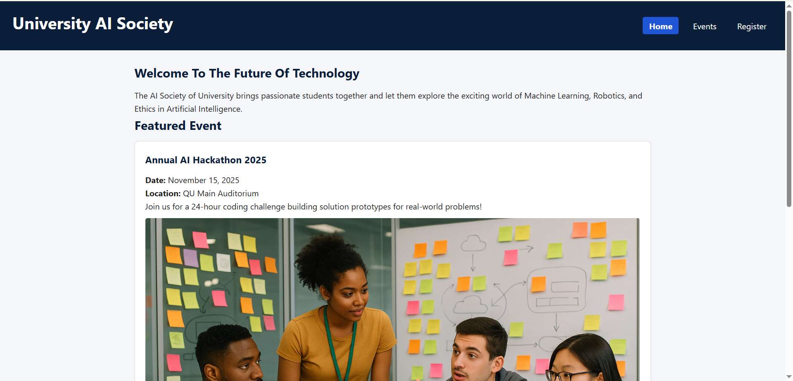

# University AI Society Website

A responsive multi-page website for the University AI Society built by using semantic HTML5, CSS3, and JavaScript form previous labs.

## Live Website & Repository Links
* **Live Site (GitHub Pages):** https://abdul-rehman1100.github.io/ai-society-club
* **GitHub Repository:** https://github.com/Abdul-Rehman1100/ai-society-club.git

## Website Pages
1. `index.html` — Homepage featuring club introduction, upcoming events preview, and committee contact box.
2. `events.html` — Detailed listing of 4 upcoming artificial intelligence club events structured with semantic `<article>` elements.
3. `register.html` — Interactive event registration form with built-in HTML5 validation, submitting to browser `localStorage` and dynamically rendering saved records in a table.

## Local Setup Instructions
1. Clone the repository: `https://github.com/Abdul-Rehman1100/ai-society-club.git`
2. Navigate into the directory: `cd ai-society-club`
3. Open `index.html` directly in any web browser.

## Homepage Screenshot
